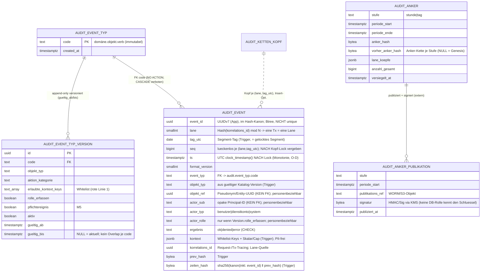

# DB-Schema-Skizze — ADR-0003 Unveränderliches Audit-Log

- **Status:** Entwurf (Phase 2, Design) — **KEINE Migration.** Schema-**Skizze** für die
  Lead-Reviews. **Beide Lead-Reviews (`audit-trail-engineer` + `security-lead`)
  abgeschlossen (2026-07-09) und hier eingearbeitet.** Umsetzung als versionierte Migration
  später über `/add-migration` (Review `database-lead` + `compliance-director`, DDL-Rule
  `.claude/rules/database-migrations.md`, inkl. `REVOKE`-Pflicht auf `audit`).
  `migrations/` bleibt in Phase 2 **unverändert** (Schema `audit` ist in V0002 bewusst NICHT
  angelegt, dortige Abweichung (f)).
- **Bezug:** `docs/adr/ADR-0003-audit-log.md` (Teil B, §11–§23 + Anhänge D/E/F). Konsistent
  zu ADR-0004 §12–§16 und `schemas/database/adr-0004-kern-datenmodell.md`.
- **Design-Owner:** technical-director · **Reviews:** audit-trail-engineer, security-lead
  (abgeschlossen, eingearbeitet)
- **Datum:** 2026-07-09

> **Wichtig:** Die folgenden `CREATE`/`REVOKE`/`GRANT`-Anweisungen sind
> **Entwurfsskizzen**, **nicht** ausführungsreife Migrationen. Sie folgen bereits den
> Konventionen (append-only, `REVOKE` atomar mit der Tabellenanlage, `sha256` aus dem
> Postgres-Core statt pgcrypto, `create_hypertable` nur Apache-2), damit `/add-migration`
> sie direkt übernehmen kann. Feinpunkte (Lane-N, Gnadenfrist-Dauer, KMS/WORM) siehe §7.

---

## 1. Namensraum (Schema `audit`)

| Objekt | Art | PII? | Append-only / `REVOKE`? |
|--------|-----|------|-------------------------|
| `audit.event` | **Hypertable** (Zeitreihe) | Nein (opake/pseudonyme Refs) | **Ja** — `REVOKE UPDATE, DELETE` (rote Linie 3, M1) |
| `audit.anker` | Tabelle (stündlich + täglich) | Nein | **Ja** — nach Versiegelung immutable |
| `audit.anker_publikation` | Tabelle (Publikations-/Signatur-Nachweis) | Nein | **Ja** — nur INSERT via `markiere_publiziert()` |
| `audit.event_typ` | Katalog-Header (`code` immutabel) | Nein | **Nein** — governte Config; FK-Ziel |
| `audit.event_typ_version` | Katalog-Version (append-only, SCD2) | Nein | **Nein** — governt; append-only versioniert |
| `audit.ketten_kopf` | Arbeitstabelle (Insert-Optimierung) | Nein | **Nein** — aus `event` rekonstruierbar, kein Vertrauensanker |
| `audit.retention_freigabe` | Vier-Augen-Kontrolltabelle | Nein | **Nein** — Betriebs-Freigaben |

**Rote Linie 2 (verbindlich):** **Kein** FK von `audit.*` nach `identity`/`energy`/User.
`actor_sub` (Keycloak-`sub`) und `objekt_ref` (Pseudonym/Entity-UUID) sind **opake Werte**;
Auflösung nur über getrennte Systeme (ADR-0002 / `identity`) als autorisierter, selbst
wieder auditierter Vorgang.

```sql
CREATE SCHEMA IF NOT EXISTS audit;
-- Extensions aus V0001: timescaledb (Apache-2/-oss), btree_gist (fuer EXCLUDE, §3.1).
-- KEIN pgcrypto: Ketten-Hash nutzt Core sha256(bytea) (PG >= 11); Anker-SIGNATUR
-- entsteht ausserhalb der DB (KMS-Schluessel, den keine DB-Rolle kennt, §4.4/O-E).
```

---

## 2. ERD (Mermaid)

> `audit.event → audit.event_typ` ist jetzt **echter FK** (`ON UPDATE NO ACTION ON DELETE
> NO ACTION`; `ON UPDATE CASCADE` **verboten** — würde historische Zeilen ändern und die
> Hash-Kette flächig invalidieren, O-A). `audit.event → identity/energy` bleibt **FK-los**
> (rote Linie 2). Katalog **append-only versioniert** (Header + Version, O-A/Finding 3).



---

## 3. DDL-Skizze `audit`

### 3.1 Katalog (append-only versioniert) + Ketten-Kopf + Retention-Freigabe

```sql
-- Header: code immutabel, FK-Ziel. NICHT unter REVOKE (governte Config).
CREATE TABLE audit.event_typ (
    code        text PRIMARY KEY,                 -- namespaced domäne.objekt.verb
    created_at  timestamptz NOT NULL DEFAULT now()
);

-- Version (SCD2, append-only): Aenderung = neue Zeile; Vorgaenger bekommt gueltig_bis.
-- Kein Overlap je code (btree_gist, V0001). Aenderung selbst = Pflicht-Audit-Event.
CREATE TABLE audit.event_typ_version (
    id                    uuid PRIMARY KEY,        -- App: UUIDv7, kein DB-DEFAULT
    code                  text NOT NULL REFERENCES audit.event_typ(code),
    objekt_typ            text NOT NULL,
    aktion_kategorie      text NOT NULL,           -- erstellen|lesen|aendern|loeschen|exportieren|freigeben|anmelden|...
    erlaubte_kontext_keys text[] NOT NULL DEFAULT '{}',   -- Whitelist (rote Linie 1)
    rolle_erfassen        boolean NOT NULL DEFAULT false, -- actor_rolle nur wenn true (§13.4)
    pflichtereignis       boolean NOT NULL DEFAULT false, -- M5
    aktiv                 boolean NOT NULL DEFAULT true,
    beschreibung          text NOT NULL,
    gueltig_ab            timestamptz NOT NULL,
    gueltig_bis           timestamptz,             -- NULL = aktuell
    created_at            timestamptz NOT NULL DEFAULT now(),
    CONSTRAINT ex_event_typ_version_no_overlap EXCLUDE USING gist (
        code WITH =, tstzrange(gueltig_ab, gueltig_bis) WITH &&
    )
);

-- Ketten-Kopf: laufender Kopf je Segment. Insert-Optimierung; kein Vertrauensanker
-- (Verifikation §5 rechnet unabhaengig aus den Ereigniszeilen nach). Nur der
-- SECURITY-DEFINER-Seal-Trigger pflegt ihn.
CREATE TABLE audit.ketten_kopf (
    lane         smallint    NOT NULL,
    tag_utc      date        NOT NULL,
    letzter_seq  bigint      NOT NULL,
    letzter_hash bytea       NOT NULL,
    anzahl       bigint      NOT NULL,
    updated_at   timestamptz NOT NULL DEFAULT now(),
    PRIMARY KEY (lane, tag_utc)
);

-- Vier-Augen-Kontrolltabelle fuer den Retention-Sonderpfad (O-F).
CREATE TABLE audit.retention_freigabe (
    id                 uuid PRIMARY KEY,           -- App: UUIDv7
    chunk_aelter_als   timestamptz NOT NULL,       -- drop_chunks-Grenze
    antragsteller      text NOT NULL,
    freigeber          text,                       -- muss <> antragsteller (Vier-Augen)
    compliance_ref     text,                       -- Verweis compliance/audit-reports/
    export_verifiziert boolean NOT NULL DEFAULT false,  -- Row-Count/Checksum + Anker-Manifest
    status             text NOT NULL DEFAULT 'offen',   -- offen|freigegeben|ausgefuehrt
    created_at         timestamptz NOT NULL DEFAULT now(),
    CONSTRAINT ck_freigabe_vier_augen CHECK (freigeber IS NULL OR freigeber <> antragsteller)
);
```

### 3.2 Anker (stündlich + täglich) + Publikations-Nachweis (append-only)

```sql
-- Verallgemeinerter Anker (O-E/a): stuendliche Zwischen-Anker senken das
-- Manipulationsfenster von 24h auf ~1h; Tages-Anker fasst den Tag. Je Stufe eine
-- eigene Anker-Kette (vorher_anker_hash). Append-only (nur INSERT beim Versiegeln).
CREATE TABLE audit.anker (
    stufe             text        NOT NULL,        -- stunde|tag
    periode_start     timestamptz NOT NULL,        -- Periodenbeginn (UTC)
    periode_ende      timestamptz NOT NULL,        -- exklusiv
    anker_hash        bytea       NOT NULL,
    vorher_anker_hash bytea,                        -- NULL = Genesis der Stufe
    lane_koepfe       jsonb       NOT NULL,         -- {lane: {seq, anzahl, head_hash(hex)}}
    anzahl_gesamt     bigint      NOT NULL,
    versiegelt_at     timestamptz NOT NULL DEFAULT now(),
    PRIMARY KEY (stufe, periode_start),
    CONSTRAINT ck_anker_stufe CHECK (stufe IN ('stunde','tag'))
);

-- Publikations-/Signatur-Nachweis getrennt gehalten -> audit.anker bleibt append-only
-- (kein spaeteres Spalten-UPDATE). Nur INSERT via markiere_publiziert() (§4.4).
CREATE TABLE audit.anker_publikation (
    stufe            text        NOT NULL,
    periode_start    timestamptz NOT NULL,
    publikations_ref text        NOT NULL,          -- WORM/S3-Objekt (Object-Lock/Compliance-Mode)
    signatur         bytea       NOT NULL,          -- HMAC/Sig, extern via KMS erzeugt (O-E/b)
    publiziert_at    timestamptz NOT NULL DEFAULT now(),
    PRIMARY KEY (stufe, periode_start),
    FOREIGN KEY (stufe, periode_start) REFERENCES audit.anker(stufe, periode_start)
);
```

### 3.3 Event-Envelope (Hypertable)

```sql
-- event_id (UUIDv7, App) IM Hash-Kanon (O-B) -- sonst einziges Feld ausserhalb des
-- Ankers. KEIN UUID-PK (dok. Abweichung, analog measurement.messwert ADR-0004 §14):
-- natuerlicher Ketten-Schluessel (lane, tag_utc, seq); event_id nur Btree (nicht unique,
-- Timescale-Partitionsspalten-Regel).
CREATE TABLE audit.event (
    event_id        uuid         NOT NULL,          -- App UUIDv7; im Kanon (O-B)
    lane            smallint     NOT NULL,          -- App: Hash(korrelations_id) mod N (§4.2-Kommentar)
    tag_utc         date         NOT NULL,          -- Trigger: = gelocktes Segment (§4.2)
    seq             bigint       NOT NULL,          -- Trigger: NACH Kopf-Lock
    ts              timestamptz  NOT NULL,          -- Trigger: clock_timestamp() NACH Lock (O-D); nie emitter (Linie 5)
    format_version  smallint     NOT NULL DEFAULT 1,
    event_typ       text         NOT NULL           -- FK: NO ACTION; ON UPDATE CASCADE VERBOTEN (O-A)
                    REFERENCES audit.event_typ(code) ON UPDATE NO ACTION ON DELETE NO ACTION,
    objekt_typ      text         NOT NULL,          -- Trigger: aus gueltiger Katalog-Version
    objekt_ref      uuid,                            -- Pseudonym/Entity-UUID; KEIN FK (Linie 2)
    actor_sub       text,                            -- opake Principal-ID; KEIN FK
    actor_typ       text         NOT NULL,
    actor_rolle     text,                            -- nur wenn Version.rolle_erfassen (§13.4)
    ergebnis        text         NOT NULL,
    kontext         jsonb        NOT NULL DEFAULT '{}',
    korrelations_id uuid,
    prev_hash       bytea        NOT NULL,          -- Trigger
    zeilen_hash     bytea        NOT NULL,          -- Trigger
    CONSTRAINT ck_event_ergebnis  CHECK (ergebnis IN ('ok','denied','error')),
    CONSTRAINT ck_event_actor_typ CHECK (actor_typ IN ('benutzer','dienstkonto','system'))
);

-- DSGVO-Markierung: personenbeziehbar pseudonym (ErwGr. 26), pii=false (ADR-0003 Anhang E).
COMMENT ON COLUMN audit.event.actor_sub IS
  'personenbeziehbar=true; pii=false; art=opake-principal; grundlage=Art.32/Art.5(2); zweckbindung=Sicherheit/Rechenschaft, NICHT Leistungs-/Verhaltenskontrolle (Art.88 DSGVO/§26 BDSG); aufloesung=nur via ADR-0002/Keycloak (getrenntes System, KEIN FK); ADR-0003 Anhang E';
COMMENT ON COLUMN audit.event.objekt_ref IS
  'personenbeziehbar=true; pii=false; art=pseudonym; grundlage=Art.32/Art.5(2); aufloesung=nur via identity (ADR-0004 §16, autorisiert + selbst auditiert, KEIN FK); Art.17 via Krypto-Shredding, nie via Edit; ADR-0003 Anhang E';
COMMENT ON COLUMN audit.event.actor_rolle IS
  'personenbeziehbar=true; pii=false; art=rolle-zum-zeitpunkt; erfasst nur wenn Katalog-Version.rolle_erfassen=true (Datensparsamkeit Art.5(1)(c)); zweckbindung wie actor_sub (§7.2); ADR-0003 Anhang E';
COMMENT ON COLUMN audit.event.kontext IS
  'pii=false erzwungen: Keys = Teilmenge erlaubte_kontext_keys (Whitelist), nur Skalare (jsonb_typeof), octet_length-Cap je Wert -- Trigger + Service + CI-pii-scan (M3). KEIN Freitext-Einfallstor.';

-- Apache-2: create_hypertable erlaubt; Compression/Retention/CAgg-Policies TSL -> verboten.
-- Chunk 1 Monat (Audit-Volumen << Messwerte); deckt Monats-Pruef-/Anker-/Retention-Takt.
SELECT create_hypertable('audit.event', 'ts', chunk_time_interval => INTERVAL '1 month');

-- Indizes minimal (M4).
CREATE UNIQUE INDEX ux_event_lane_tag_seq
    ON audit.event (lane, tag_utc, seq, ts);       -- ts = Partitionsspalte (Timescale-Pflicht)
CREATE INDEX ix_event_objekt
    ON audit.event (objekt_typ, objekt_ref, ts) WHERE objekt_ref IS NOT NULL;  -- Persona A
CREATE INDEX ix_event_id
    ON audit.event (event_id);                     -- Punkt-Lookups; NICHT unique (O-B)
-- BEWUSST KEIN (actor_sub, ...)-Index: M4 + §7.2 (kein Beschaeftigten-Profiling).
-- Default-ts-Index legt create_hypertable an.
```

---

## 4. Trigger, Hash, Kanonisierung, Anker, Wrapper (Pseudocode-nah)

### 4.1 Längenpräfix-Kanonisierung (identisch in Seal-Trigger und `pruefe_kette`, Anhang D)

```sql
CREATE FUNCTION audit.lp(v text) RETURNS bytea LANGUAGE sql IMMUTABLE AS $$
  SELECT CASE WHEN v IS NULL THEN '\xffffffff'::bytea
              ELSE int4send(octet_length(v)) || convert_to(v, 'UTF8') END;   -- int4send = 4-Byte BE
$$;

-- Kanonische Bytefolge EINER Ereigniszeile (ohne prev_hash/zeilen_hash).
-- event_id IM Kanon (O-B). ts als EPOCH-MIKROSEKUNDEN (O-D): PG16 EXTRACT -> numeric,
-- exakt, kein Float-Drift; verbindlich statt ISO-Text. Golden-Byte-Test pinnt die
-- Bytefolge ueber PG-Major-Upgrades (§7, Finding 1).
CREATE FUNCTION audit.canon_event(
    p_format_version smallint, p_event_id uuid, p_tag_utc date, p_lane smallint, p_seq bigint,
    p_ts timestamptz, p_event_typ text, p_objekt_typ text, p_objekt_ref uuid,
    p_actor_sub text, p_actor_typ text, p_actor_rolle text, p_ergebnis text,
    p_kontext jsonb, p_korrelations_id uuid
) RETURNS bytea LANGUAGE sql IMMUTABLE AS $$
  SELECT audit.lp(p_format_version::text) || audit.lp(p_event_id::text)
      || audit.lp(p_tag_utc::text) || audit.lp(p_lane::text) || audit.lp(p_seq::text)
      || audit.lp(((EXTRACT(EPOCH FROM p_ts) * 1000000)::bigint)::text)   -- Epoch-Mikrosekunden
      || audit.lp(p_event_typ) || audit.lp(p_objekt_typ) || audit.lp(p_objekt_ref::text)
      || audit.lp(p_actor_sub) || audit.lp(p_actor_typ) || audit.lp(p_actor_rolle)
      || audit.lp(p_ergebnis) || audit.lp(p_kontext::text) || audit.lp(p_korrelations_id::text);
$$;

CREATE FUNCTION audit.genesis(p_format_version smallint, p_lane smallint, p_tag_utc date)
RETURNS bytea LANGUAGE sql IMMUTABLE AS $$
  SELECT sha256(convert_to('AUDIT-GEN-v'||p_format_version||'|'||p_lane||'|'||p_tag_utc, 'UTF8'));
$$;
```

### 4.2 Seal-Trigger — **Reihenfolge-Fix (O-D)**: erst Lock, dann `ts`

> **Lane-Zuweisung (O-C) = Service-seitig:** `NEW.lane := hashtext(korrelations_id) mod N`
> (nicht Round-Robin/connection-gebunden; eine Tx = eine Lane = ein Lock). Der Trigger
> nimmt `NEW.lane` als gegeben und lockt genau dieses Segment.

```sql
CREATE FUNCTION audit.event_seal() RETURNS trigger
    LANGUAGE plpgsql SECURITY DEFINER SET search_path = audit, pg_temp AS $$
DECLARE
    v_ver   audit.event_typ_version%ROWTYPE;
    v_tag   date;
    v_prev  bytea;
    v_seq   bigint;
    v_bad   text[];
BEGIN
    -- lock_timeout/statement_timeout: via ALTER ROLE edms_app gesetzt (§6.7) -> blockierter
    -- Kopf-Lock scheitert alarmierbar statt zu haengen (STRIDE, security-lead).

    -- (1) Provisorischer Tag NUR zur Segment-Bestimmung; finales ts kommt NACH dem Lock.
    v_tag := (clock_timestamp() AT TIME ZONE 'UTC')::date;

    -- (2) Segment-Kopf sicherstellen (idempotent) und exklusiv locken -> race-frei.
    INSERT INTO audit.ketten_kopf (lane, tag_utc, letzter_seq, letzter_hash, anzahl)
    VALUES (NEW.lane, v_tag, 0, audit.genesis(NEW.format_version, NEW.lane, v_tag), 0)
    ON CONFLICT (lane, tag_utc) DO NOTHING;
    SELECT letzter_seq, letzter_hash INTO v_seq, v_prev
      FROM audit.ketten_kopf WHERE lane = NEW.lane AND tag_utc = v_tag
      FOR UPDATE;                                   -- Serialisierungspunkt = genau EIN Segment

    -- (3) ERST NACH dem Lock ts setzen -> Monotonie (seq steigt <=> ts steigt), O-D-Fix.
    --     tag_utc = gelocktes Segment (Mitternachts-Edge deterministisch aufgeloest).
    NEW.ts        := clock_timestamp();
    NEW.tag_utc   := v_tag;
    NEW.seq       := v_seq + 1;
    NEW.prev_hash := v_prev;

    -- (4) Gueltige Katalog-Version zum ts aufloesen (append-only SCD2).
    SELECT * INTO v_ver FROM audit.event_typ_version
     WHERE code = NEW.event_typ AND aktiv
       AND gueltig_ab <= NEW.ts AND (gueltig_bis IS NULL OR NEW.ts < gueltig_bis);
    IF NOT FOUND THEN
        RAISE EXCEPTION 'audit: keine gueltige/aktive Katalog-Version fuer % @ %', NEW.event_typ, NEW.ts;
    END IF;
    NEW.objekt_typ := v_ver.objekt_typ;             -- autoritativ aus Katalog
    IF NOT v_ver.rolle_erfassen THEN NEW.actor_rolle := NULL; END IF;   -- Datensparsamkeit (§13.4)

    -- (5) Kontext: Whitelist + nur Skalare + Groessen-Cap (O-H).
    SELECT array_agg(k) INTO v_bad FROM jsonb_object_keys(NEW.kontext) k
     WHERE k <> ALL (v_ver.erlaubte_kontext_keys);
    IF v_bad IS NOT NULL THEN
        RAISE EXCEPTION 'audit: kontext-key(s) nicht in Whitelist von %: %', NEW.event_typ, v_bad;
    END IF;
    IF EXISTS (SELECT 1 FROM jsonb_each(NEW.kontext) e
               WHERE jsonb_typeof(e.value) NOT IN ('string','number','boolean')
                  OR octet_length(e.value::text) > 512) THEN                -- Cap = Skizze, Phase 4
        RAISE EXCEPTION 'audit: kontext-Wert nicht skalar oder ueber Cap (%)', NEW.event_typ;
    END IF;

    -- (6) Siegeln + Kopf fortschreiben.
    NEW.zeilen_hash := sha256(
        audit.canon_event(NEW.format_version, NEW.event_id, NEW.tag_utc, NEW.lane, NEW.seq,
            NEW.ts, NEW.event_typ, NEW.objekt_typ, NEW.objekt_ref, NEW.actor_sub, NEW.actor_typ,
            NEW.actor_rolle, NEW.ergebnis, NEW.kontext, NEW.korrelations_id) || v_prev);
    UPDATE audit.ketten_kopf
       SET letzter_seq = NEW.seq, letzter_hash = NEW.zeilen_hash, anzahl = anzahl + 1, updated_at = now()
     WHERE lane = NEW.lane AND tag_utc = NEW.tag_utc;
    RETURN NEW;
END;
$$;

CREATE TRIGGER trg_event_seal BEFORE INSERT ON audit.event
    FOR EACH ROW EXECUTE FUNCTION audit.event_seal();
```

### 4.3 Anker versiegeln (Stufe stunde/tag) — inkl. Sichtbarkeits-Gnadenfrist (O-G)

```sql
-- Sammelt je lane den Ketten-Stand zum periode_ende (fuer 'tag' == Tages-Endstand,
-- fuer 'stunde' == kumulativer Stand bis Stundenende) und kettet an den vorherigen
-- Anker DERSELBEN Stufe. Selbst ein Pflicht-Audit-Event (STRIDE).
CREATE FUNCTION audit.versiegle(p_stufe text, p_start timestamptz) RETURNS bytea
    LANGUAGE plpgsql SECURITY DEFINER SET search_path = audit, pg_temp AS $$
DECLARE
    p_ende  timestamptz := p_start + CASE p_stufe WHEN 'stunde' THEN INTERVAL '1 hour' ELSE INTERVAL '1 day' END;
    v_prev  bytea; v_canon bytea; v_summe bigint := 0; v_anker bytea; r RECORD;
BEGIN
    -- O-G: echtes Risiko = Transaktions-Sichtbarkeits-Latenz (vor der Grenze gestartete,
    -- danach committende Tx), nicht Uhren-Skew. Versiegeln nur, wenn KEINE vor p_ende
    -- gestartete Client-Tx mehr offen ist (aktive Gnadenfrist-Pruefung).
    IF EXISTS (SELECT 1 FROM pg_stat_activity
               WHERE xact_start < p_ende AND state <> 'idle' AND backend_type = 'client backend') THEN
        RAISE EXCEPTION 'audit: Versiegelung % @ % verschoben -- offene Tx vor Periodengrenze', p_stufe, p_start;
    END IF;

    SELECT anker_hash INTO v_prev FROM audit.anker
     WHERE stufe = p_stufe AND periode_start = (p_start - (p_ende - p_start));   -- vorherige Periode der Stufe

    v_canon := audit.lp(p_stufe) || audit.lp(p_start::text);
    FOR r IN                                        -- je lane letzter Stand bis p_ende
        SELECT DISTINCT ON (e.lane) e.lane, e.seq, e.zeilen_hash,
               count(*) OVER (PARTITION BY e.lane) AS anzahl
          FROM audit.event e
         WHERE e.tag_utc = (p_start AT TIME ZONE 'UTC')::date AND e.ts < p_ende
         ORDER BY e.lane, e.seq DESC
    LOOP
        v_canon := v_canon || audit.lp(r.lane::text) || audit.lp(r.seq::text)
                 || audit.lp(r.anzahl::text) || r.zeilen_hash;
        v_summe := v_summe + r.anzahl;
    END LOOP;
    v_canon := v_canon || audit.lp(v_summe::text) || COALESCE(v_prev, ''::bytea);
    v_anker := sha256(v_canon);

    INSERT INTO audit.anker (stufe, periode_start, periode_ende, anker_hash, vorher_anker_hash,
                             lane_koepfe, anzahl_gesamt)
    VALUES (p_stufe, p_start, p_ende, v_anker, v_prev, '{}'::jsonb, v_summe);   -- lane_koepfe-Snapshot: Detail P4
    -- + Pflicht-Audit-Event 'audit.anker.versiegelt' (INSERT INTO audit.event ...).
    RETURN v_anker;
END;
$$;
```

### 4.4 Publikation (dedizierte Identität, extern signiert) — `markiere_publiziert()`

```sql
-- Nur INSERT in anker_publikation (audit.anker bleibt append-only). Signatur wird
-- AUSSERHALB der DB erzeugt (KMS-Schluessel, den keine DB-Rolle kennt, O-E/b) und hier
-- als Nachweis abgelegt. Selbst ein Pflicht-Audit-Event.
CREATE FUNCTION audit.markiere_publiziert(p_stufe text, p_start timestamptz,
                                          p_ref text, p_signatur bytea) RETURNS void
    LANGUAGE plpgsql SECURITY DEFINER SET search_path = audit, pg_temp AS $$
BEGIN
    INSERT INTO audit.anker_publikation (stufe, periode_start, publikations_ref, signatur)
    VALUES (p_stufe, p_start, p_ref, p_signatur);
    -- + Pflicht-Audit-Event 'audit.anker.publiziert'.
END;
$$;
```

### 4.5 Retention-Wrapper `retention_drop()` (Vier-Augen) + DDL-Event-Trigger (O-F)

```sql
-- Einziger Pfad zu drop_chunks('audit.event', ...). Prueft Vier-Augen-Freigabe +
-- verifizierten Cold-Export gegen die Kontrolltabelle und loest ein Pflicht-Audit-Event
-- aus. edms_audit_betrieb bekommt NUR EXECUTE hierauf, KEIN direktes drop_chunks/UPDATE.
CREATE FUNCTION audit.retention_drop(p_freigabe_id uuid) RETURNS void
    LANGUAGE plpgsql SECURITY DEFINER SET search_path = audit, pg_temp AS $$
DECLARE f audit.retention_freigabe%ROWTYPE;
BEGIN
    SELECT * INTO f FROM audit.retention_freigabe WHERE id = p_freigabe_id;
    IF NOT FOUND OR f.status <> 'freigegeben' OR f.freigeber IS NULL
       OR f.freigeber = f.antragsteller OR NOT f.export_verifiziert THEN
        RAISE EXCEPTION 'audit: Retention-Freigabe % ungueltig (Vier-Augen/Export fehlt)', p_freigabe_id;
    END IF;
    PERFORM drop_chunks('audit.event', older_than => f.chunk_aelter_als);   -- Apache-2, erlaubt
    UPDATE audit.retention_freigabe SET status = 'ausgefuehrt' WHERE id = p_freigabe_id;
    -- + Pflicht-Audit-Event 'audit.retention.drop' (wer/Grenze/Freigabe-Referenz).
END;
$$;

-- DDL-Event-Trigger: meldet JEDE DDL im Schema audit extern (pg_notify -> Listener/SIEM).
-- Kompensation gegen Funktions-Replacement durch den Owner (in der Kette selbst unsichtbar).
CREATE FUNCTION audit.melde_ddl() RETURNS event_trigger LANGUAGE plpgsql AS $$
DECLARE o RECORD;
BEGIN
    FOR o IN SELECT * FROM pg_event_trigger_ddl_commands()
             WHERE schema_name = 'audit' OR object_identity LIKE 'audit.%' LOOP
        PERFORM pg_notify('audit_ddl', o.command_tag || ' ' || COALESCE(o.object_identity,''));
    END LOOP;
END;
$$;
CREATE EVENT TRIGGER trg_audit_ddl ON ddl_command_end EXECUTE FUNCTION audit.melde_ddl();
```

---

## 5. Integritätsprüfung (deterministisch, read-only — M2 / Phase-7-Gate)

```sql
-- Rechnet Lane-Ketten (inkl. event_id im Kanon) + Anker NEU und vergleicht gegen die
-- gespeicherten Werte. Der externe Abgleich gegen die PUBLIZIERTEN, SIGNIERTEN Anker
-- (audit.anker_publikation + WORM/S3) deckt privilegierte Manipulation auf und haelt die
-- Kette ueber archivierte/gedropte Chunks (§18/§19 ADR); dieser Abgleich laeuft im
-- Monats-Job gegen das Manifest + KMS-Signatur-Verifikation, ausserhalb dieser Fn.
CREATE FUNCTION audit.pruefe_kette(p_von date, p_bis date)
RETURNS TABLE (tag_utc date, lane smallint, status text, erste_verletzung bigint, detail text)
LANGUAGE plpgsql STABLE AS $$
DECLARE r RECORD; v_prev bytea; v_erwart bigint; v_recomp bytea;
BEGIN
    FOR tag_utc, lane IN
        SELECT DISTINCT e.tag_utc, e.lane FROM audit.event e
         WHERE e.tag_utc BETWEEN p_von AND p_bis ORDER BY 1,2
    LOOP
        v_prev := audit.genesis(
            (SELECT min(format_version) FROM audit.event
              WHERE event.tag_utc = pruefe_kette.tag_utc AND event.lane = pruefe_kette.lane),
            pruefe_kette.lane, pruefe_kette.tag_utc);
        v_erwart := 0; status := 'ok'; erste_verletzung := NULL; detail := NULL;
        FOR r IN
            SELECT * FROM audit.event e
             WHERE e.tag_utc = pruefe_kette.tag_utc AND e.lane = pruefe_kette.lane
             ORDER BY e.seq
        LOOP
            v_erwart := v_erwart + 1;
            v_recomp := sha256(
                audit.canon_event(r.format_version, r.event_id, r.tag_utc, r.lane, r.seq, r.ts,
                    r.event_typ, r.objekt_typ, r.objekt_ref, r.actor_sub, r.actor_typ,
                    r.actor_rolle, r.ergebnis, r.kontext, r.korrelations_id) || v_prev);
            IF r.seq <> v_erwart THEN
                status := 'LUECKE'; erste_verletzung := v_erwart; detail := 'seq-Sprung'; EXIT;
            ELSIF r.prev_hash <> v_prev OR r.zeilen_hash <> v_recomp THEN
                status := 'MANIPULATION'; erste_verletzung := r.seq; detail := 'hash-Mismatch'; EXIT;
            END IF;
            v_prev := r.zeilen_hash;
        END LOOP;
        RETURN NEXT;
    END LOOP;
    -- Anker-Kette (je Stufe) + Abgleich gegen anker_publikation/Manifest: Monats-Job,
    -- inkl. KMS-Signatur-Verifikation (verkuerzt; analog audit.versiegle).
END;
$$;
```

---

## 6. Rollen, `GRANT` / `REVOKE`, Timeouts (atomar in derselben Migration — rote Linie 3)

```sql
-- 6.1 Rollen (NOLOGIN-Gruppenrollen).
CREATE ROLE edms_audit_owner   NOLOGIN;   -- Owner der Objekte + SECURITY-DEFINER-Fns; nur Setup (Owner <> Superuser)
CREATE ROLE edms_app           NOLOGIN;   -- Runtime-Schreibpfad (nur ueber Seal-Trigger gesiegelt)
CREATE ROLE edms_audit_betrieb NOLOGIN;   -- privilegierter Betrieb: NUR EXECUTE auf Wrapper (kein drop_chunks/UPDATE)
CREATE ROLE edms_audit_publish NOLOGIN;   -- dedizierte Publish-Identitaet (O-E/c); kennt den KMS-Signaturschluessel

-- 6.2 Ownership (Owner <> Superuser, O-F).
ALTER SCHEMA audit OWNER TO edms_audit_owner;
-- ... alle audit.*-Tabellen + Funktionen (event_seal, versiegle, markiere_publiziert,
--     retention_drop, melde_ddl, pruefe_kette, canon_event, lp, genesis) OWNER TO edms_audit_owner.

-- 6.3 UNVERAENDERLICHKEIT atomar (M1) -- direkt mit der Tabellenanlage.
REVOKE UPDATE, DELETE, TRUNCATE ON audit.event             FROM PUBLIC;
REVOKE UPDATE, DELETE, TRUNCATE ON audit.anker             FROM PUBLIC;
REVOKE UPDATE, DELETE, TRUNCATE ON audit.anker_publikation FROM PUBLIC;

-- 6.4 App-Rolle: NUR INSERT+SELECT auf event; SELECT auf Katalog/Anker; EXECUTE Pruef-Fn.
--     KEIN Zugriff auf ketten_kopf (Seal-Trigger als SECURITY DEFINER pflegt ihn).
GRANT USAGE   ON SCHEMA audit                       TO edms_app;
GRANT INSERT, SELECT ON audit.event                 TO edms_app;
GRANT SELECT  ON audit.event_typ, audit.event_typ_version, audit.anker, audit.anker_publikation TO edms_app;
GRANT EXECUTE ON FUNCTION audit.pruefe_kette(date, date) TO edms_app;

-- 6.5 Betriebsrolle: NUR EXECUTE auf die schmalen Wrapper + Katalog-Pflege. KEIN
--     direktes drop_chunks/UPDATE/DELETE auf event (Zeilen-Manipulation ist kein
--     legitimer Betriebsvorgang).
GRANT USAGE   ON SCHEMA audit                       TO edms_audit_betrieb;
GRANT SELECT, INSERT ON audit.event_typ, audit.event_typ_version TO edms_audit_betrieb;  -- /add-audit-event (append-only)
GRANT INSERT, SELECT, UPDATE ON audit.retention_freigabe TO edms_audit_betrieb;          -- Vier-Augen-Workflow
GRANT EXECUTE ON FUNCTION audit.versiegle(text, timestamptz)  TO edms_audit_betrieb;
GRANT EXECUTE ON FUNCTION audit.retention_drop(uuid)          TO edms_audit_betrieb;

-- 6.6 Publish-Identitaet: NUR Publikations-Markierung (+ externer WORM/S3-/KMS-Zugriff
--     ausserhalb der DB). Getrennt von edms_audit_betrieb (SoD).
GRANT USAGE   ON SCHEMA audit                       TO edms_audit_publish;
GRANT EXECUTE ON FUNCTION audit.markiere_publiziert(text, timestamptz, text, bytea) TO edms_audit_publish;

-- 6.7 Timeouts (STRIDE): blockierter Kopf-Lock scheitert alarmierbar statt zu haengen.
ALTER ROLE edms_app SET lock_timeout      = '2s';    -- Werte = Skizze, Phase-4-Tuning
ALTER ROLE edms_app SET statement_timeout = '10s';

-- 6.8 Grenze des REVOKE: bindet NICHT Owner/Superuser -> die Hash-Kette + der EXTERN
--     signierte, publizierte Anker (§4.4/O-E) sind die eigentliche Absicherung gegen
--     privilegierten Zugriff (F1). Der ddl_command_end-Event-Trigger (§4.5) meldet
--     zusaetzlich Owner-DDL (Funktions-Replacement) extern.
```

**Dev-Single-User (`DATABASE_URL=…edms`):** Rollen als Gruppenrollen; Dev-`edms` erhält
Mitgliedschaft; App verbindet als `edms` und **`SET ROLE edms_app`** (bzw. dedizierte
Login-Rolle). M1-Test verbindet als `edms_app`: `INSERT` ok, `UPDATE`/`DELETE` abgewiesen.
Rollen-Nutzung im Migrations-Kopf dokumentieren.

---

## 7. Bewusste Abweichungen, Review-Einarbeitung & offene Punkte

**Bewusste Abweichungen von `.claude/rules/database-migrations.md` (dokumentiert):**
- **`event_id uuid`, aber kein UUID-*PK*** auf `audit.event` (natürlicher Ketten-Schlüssel
  `(lane, tag_utc, seq)`; `event_id` nur Btree, im Hash-Kanon; O-B).
- **Kein `updated_at`** auf append-only-Objekten (`event`, `anker`, `anker_publikation`,
  `event_typ_version`).
- **Erweiterte `COMMENT`-Konvention** (`personenbeziehbar=true; pii=false; …`) statt
  `pii=true`-Standard (Anhang E).
- **`event_typ(_version)` / `ketten_kopf` / `retention_freigabe` nicht unter `REVOKE`**
  (governte Config bzw. rekonstruierbare/Betriebs-Objekte, keine Beweismittel).

**Eingearbeitete Lead-Review-Voten (Kurzspiegel, Detail ADR §22):**
O-A FK + `CASCADE`-Verbot (§3.3) · O-B `event_id` im Kanon (§3.3/§4.1) · O-C Lane =
Hash(`korrelations_id`) (Service, §4.2) · O-D `ts` nach Lock + Epoch-Mikrosekunden
(§4.1/§4.2) · O-E stündliche + signierte Anker, Publish-Identität, `markiere_publiziert()`
(§3.2/§4.4/§6) · O-F `retention_drop()`-Wrapper + `ddl_command_end`-Trigger (§4.5) · O-G
Sichtbarkeits-Gnadenfrist via `pg_stat_activity` (§4.3) · O-H Werte-Cap im Trigger (§4.2) ·
Katalog-Versionierung (§3.1) · Golden-Byte-Tests + Timeouts (§4.1/§6.7).

**Konsistenz mit ADR-0004 / `dependencies.md`:** Schema-Namensraum-Muster, opake
Principal-/Pseudonym-Refs ohne Hart-FK (Linie 2), `create_hypertable` + `drop_chunks`
(via Wrapper) als einzige Apache-2-Timescale-Funktionen, **kein** Compression/Retention/
CAgg-Policy (TSL), **kein pgcrypto** (Core-`sha256`; Anker-Signatur extern via KMS).

**Offene Punkte für die User-Freigabe (Detail ADR §23):**

| # | Punkt | Art / Zuständig |
|---|-------|-----------------|
| A-O1 | Lane-N (Start 16) + Round-Robin vs. Korrelations-Hash | Phase-4-Benchmark (M4: Burst + Skew) |
| A-O2 | Anker-Kadenz: stündlich vs. nur täglich (24h-Restrisiko) | `compliance-director`-Gegenzeichnung |
| A-O3 | **KMS/Vault für Anker-Signatur** (Schlüssel, den keine DB-Rolle kennt) | **koppelt an ADR-0004 Hosting-/KMS-Input** + `security-`/`devops-lead` |
| A-O4 | WORM/S3 + Publish-Identität (Object-Lock/Compliance-Mode, Retention ≥ Horizont) | `devops-`/`security-lead` (ADR-0005-Vorwirkung) |
| A-O5 | Gnadenfrist-Dauer (max. Tx-Laufzeit über die Periodengrenze) + `lock_timeout`-Tuning | Phase-4 / `audit-trail-engineer` |
| P4-1 | `octet_length`-Cap-Wert + N + Chunk-Benchmark final | `timescale-`/`performance-engineer` |
| P4-2 | Golden-Byte-Regressionstests (PG-Major-Upgrade-Gate) | `test-engineer` |
| P4-3 | Down-Migration (`DROP SCHEMA audit CASCADE` + Rollen-/Event-Trigger-Rückbau) | `database-lead` |
| A-O8 | **Phase 3 (zwingend vor Impl.):** VT-0002, TOM-Logging, DSFA-0001-Nachtrag, SoA A.8.15/A.5.28/A.8.16/A.8.17/A.5.33 | `compliance-`/`dsgvo-`/`iso27001-auditor` |
