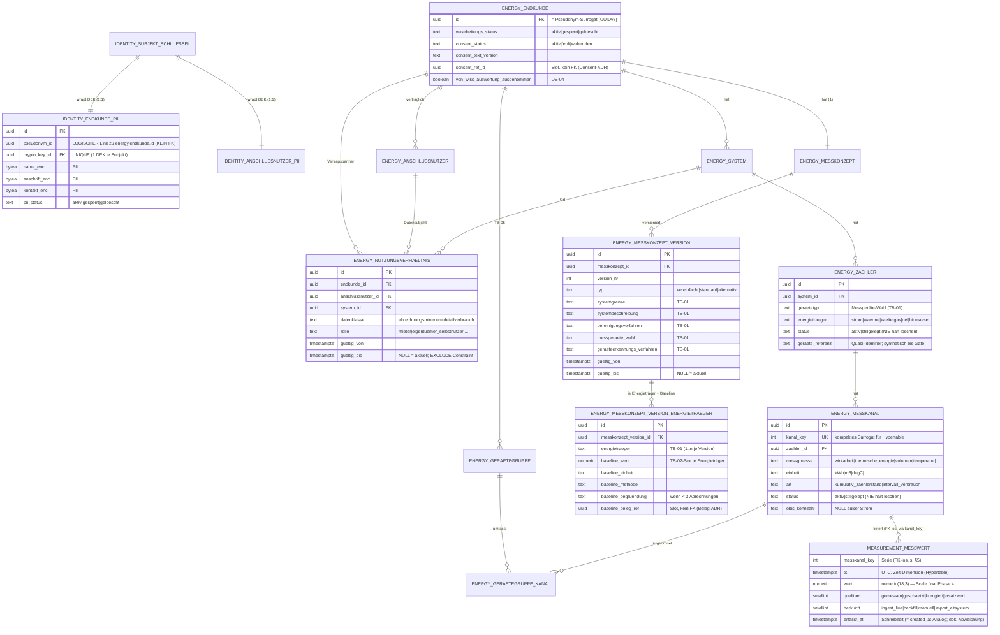

# DB-Schema-Skizze — ADR-0004 Kern-Datenmodell Energie

- **Status:** Entwurf (Phase 2, Design) — **KEINE Migration.** Diese Datei ist eine
  Schema-**Skizze** für das Review durch `database-lead` und `timescale-engineer`.
  **Beide Lead-Reviews abgeschlossen (2026-07-09) und hier eingearbeitet.** Die
  Umsetzung als versionierte Migration erfolgt später über `/add-migration` (Review
  `database-lead` + `compliance-director`, DDL-Rule
  `.claude/rules/database-migrations.md`). `migrations/` bleibt in Phase 2 **leer**.
- **Bezug:** `docs/adr/ADR-0004-kern-datenmodell-energie.md` (Teil B, Phase-2-Design)
- **Design-Owner:** technical-director · **Reviews:** database-lead, timescale-engineer
- **Datum:** 2026-07-09

> **Wichtig:** Die folgenden `CREATE`-Anweisungen sind **Entwurfsskizzen** zur
> Diskussion, **nicht** ausführungsreife Migrationen. Sie folgen bereits den
> DDL-Konventionen (UUID-PK, `created_at`, PII-Kommentare, Trigger,
> `REVOKE` auf `audit`), damit das spätere `/add-migration` sie direkt übernehmen
> kann. Verbleibende Phase-4-Punkte (z. B. finale `numeric`-Scale, EXCLUDE-Spalten)
> siehe §6.

---

## 1. Namensräume (Schemas)

| Schema | Inhalt | PII? | Separierbarkeit |
|--------|--------|------|-----------------|
| `identity` | Direkt identifizierende PII, Re-Identifikations-Mapping, Subjekt-Schlüssel, Consent-Nachweis-Anker | **Ja** | **Physisch separierbar** (späterer Vault/eigene DB, rote Linie 5) — DE-Only hostbar (DS-09) |
| `energy` | Fachdaten: Pseudonym-Endkunde, Anschlussnutzer-Beziehung, System/Messstelle, Zähler, Messkanal, Messkonzept, Gerätegruppe | **Nein** | im DSGVO-Geltungsraum hostbar (DS-09) |
| `measurement` | Messwert-Hypertable (Zeitreihe) + Qualitäts-/Herkunfts-Flags | **Nein** (pseudonym) | eigener Retention-/Archiv-Pfad |
| `audit` | **Reserviert für ADR-0003** (unveränderliches Audit-Log). `REVOKE UPDATE, DELETE`. Hier nur reserviert. | — | — |

**Rote Linie 1 & 5 (verbindlich):** **Kein** Fremdschlüssel `energy → identity`
und **kein** `identity → energy`. Die Verbindung Pseudonym ↔ reale Identität ist
**ausschließlich** ein logischer Abgleich über die Spalte `pseudonym_id` (kein
DB-FK), damit `identity` als Namensraum physisch abtrennbar bleibt. **Auch die
`updated_at`-Trigger-Funktionen sind je Schema dupliziert** (kein cross-schema-
Funktionsaufruf), damit die Separierbarkeit nicht durch eine geteilte Funktion
gebrochen wird (database-lead-Votum 5).

```sql
CREATE SCHEMA IF NOT EXISTS identity;
CREATE SCHEMA IF NOT EXISTS energy;
CREATE SCHEMA IF NOT EXISTS measurement;
-- audit: reserviert für ADR-0003, hier nicht angelegt.
CREATE EXTENSION IF NOT EXISTS btree_gist;  -- Core-Contrib, PostgreSQL-Lizenz (für EXCLUDE, §4)
```

---

## 2. ERD (Mermaid)

> Legende: Durchgezogene Kardinalitäten = **echte DB-FK** (nur innerhalb eines
> Namensraums). Die Kopplung `identity ↔ energy` über `pseudonym_id` ist
> **LOGISCH, ohne DB-FK**. `measurement → energy` ist **bewusst FK-los**
> (Durchsatz; Integrität app-seitig + Orphan-Check, §5/§6).



**Logische, FK-lose Kopplungen (rote Linie 1/5):**
`identity.endkunde_pii.pseudonym_id` → `energy.endkunde.id` und
`identity.anschlussnutzer_pii.pseudonym_id` → `energy.anschlussnutzer.id` —
**Abgleich in der Anwendung, kein `REFERENCES`.**

---

## 3. DDL-Skizze `identity` (PII, feldverschlüsselt)

```sql
-- Pro Subjekt genau ein Data-Encryption-Key (DEK), gewrappt vom KMS-Master-Key.
-- Krypto-Shredding = DEK hier vernichten -> Chiffrate werden unwiederbringlich.
CREATE TABLE identity.subjekt_schluessel (
    id             uuid PRIMARY KEY,            -- App: UUIDv7, KEIN DB-DEFAULT (Votum 6)
    wrapped_dek    bytea       NOT NULL,        -- DEK, gewrappt via KMS
    kms_key_id     text        NOT NULL,        -- Referenz auf KMS-Masterschlüssel
    alg_version    smallint    NOT NULL,        -- Krypto-Agilität (AES-256-GCM v1)
    key_state      text        NOT NULL DEFAULT 'aktiv',  -- aktiv|geschreddert
    created_at     timestamptz NOT NULL DEFAULT now(),
    geschreddert_at timestamptz
);
COMMENT ON COLUMN identity.subjekt_schluessel.wrapped_dek IS
  'pii=true; grundlage=Art.32 DSGVO (TOM Verschlüsselung); retention=an Subjekt gebunden; Löschung=Krypto-Shredding (Art.17)';

CREATE TABLE identity.endkunde_pii (
    id            uuid PRIMARY KEY,             -- App: UUIDv7, KEIN DB-DEFAULT
    pseudonym_id  uuid        NOT NULL UNIQUE,  -- LOGISCHER Link zu energy.endkunde.id (KEIN FK!)
    crypto_key_id uuid        NOT NULL UNIQUE   -- UNIQUE: 1 DEK je Subjekt (Krypto-Shredding-Garantie, Votum-Finding)
                  REFERENCES identity.subjekt_schluessel(id),
    name_enc      bytea       NOT NULL,         -- AES-256-GCM(ciphertext||nonce||tag)
    anschrift_enc bytea       NOT NULL,
    kontakt_enc   bytea,                        -- E-Mail/Telefon
    pii_status    text        NOT NULL DEFAULT 'aktiv',  -- aktiv|gesperrt|geloescht
    created_at    timestamptz NOT NULL DEFAULT now(),
    updated_at    timestamptz NOT NULL DEFAULT now()
);
COMMENT ON COLUMN identity.endkunde_pii.pseudonym_id IS
  'pii=true; grundlage=Re-Identifikations-Mapping (Verkettbarkeit); retention=an Subjekt gebunden; Löschung=Krypto-Shredding + Nullen des Mappings';
COMMENT ON COLUMN identity.endkunde_pii.name_enc IS
  'pii=true; grundlage=Art.6(1)(b) Vertrag / Art.6(1)(a) Einwilligung [Platzhalter -> DSFA/RVT]; retention=Projektlaufzeit + gesetzl. Aufbewahrung; Sperrung statt Löschung (DS-08)';
COMMENT ON COLUMN identity.endkunde_pii.anschrift_enc IS
  'pii=true; grundlage=Art.6(1)(b) Vertrag [Platzhalter -> DSFA/RVT]; retention=Projektlaufzeit + gesetzl. Aufbewahrung';
COMMENT ON COLUMN identity.endkunde_pii.kontakt_enc IS
  'pii=true; grundlage=Art.6(1)(a) Einwilligung (TB-06 Nutzerinformation) [Platzhalter]; retention=bis Widerruf/Projektende';

CREATE TABLE identity.anschlussnutzer_pii (
    id            uuid PRIMARY KEY,
    pseudonym_id  uuid        NOT NULL UNIQUE,  -- LOGISCHER Link zu energy.anschlussnutzer.id (KEIN FK!)
    crypto_key_id uuid        NOT NULL UNIQUE   -- UNIQUE: 1 DEK je Subjekt
                  REFERENCES identity.subjekt_schluessel(id),
    name_enc      bytea       NOT NULL,
    kontakt_enc   bytea,
    pii_status    text        NOT NULL DEFAULT 'aktiv',
    created_at    timestamptz NOT NULL DEFAULT now(),
    updated_at    timestamptz NOT NULL DEFAULT now()
);
COMMENT ON COLUMN identity.anschlussnutzer_pii.pseudonym_id IS
  'pii=true; grundlage=Re-Identifikations-Mapping Datensubjekt (Verkettbarkeit, DS-07); retention=an Subjekt gebunden; Löschung=Krypto-Shredding + Nullen des Mappings';
COMMENT ON COLUMN identity.anschlussnutzer_pii.name_enc IS
  'pii=true; grundlage=Art.6(1)(f)/(a) — Datensubjekt der Verbrauchsdaten (DS-07) [Platzhalter -> DSFA/RVT]; retention=Nutzungsdauer + gesetzl. Aufbewahrung; Sperrung statt Löschung (DS-08)';
COMMENT ON COLUMN identity.anschlussnutzer_pii.kontakt_enc IS
  'pii=true; grundlage=Art.6(1)(a) Einwilligung (DS-07 Datensubjekt) [Platzhalter -> DSFA/RVT]; retention=bis Widerruf/Nutzungsende';

-- updated_at-Trigger: eigene Funktion je Schema (bewusst dupliziert, rote Linie 5).
CREATE FUNCTION identity.set_updated_at() RETURNS trigger
    LANGUAGE plpgsql AS $$
BEGIN NEW.updated_at := now(); RETURN NEW; END; $$;
CREATE TRIGGER trg_endkunde_pii_updated_at BEFORE UPDATE ON identity.endkunde_pii
    FOR EACH ROW EXECUTE FUNCTION identity.set_updated_at();
CREATE TRIGGER trg_anschlussnutzer_pii_updated_at BEFORE UPDATE ON identity.anschlussnutzer_pii
    FOR EACH ROW EXECUTE FUNCTION identity.set_updated_at();
```

---

## 4. DDL-Skizze `energy` (Fachdaten, keine PII)

```sql
CREATE TABLE energy.endkunde (
    id                            uuid PRIMARY KEY,   -- = stabiler Pseudonym-Surrogat (UUIDv7, KEIN DB-DEFAULT)
    verarbeitungs_status          text NOT NULL DEFAULT 'aktiv',  -- aktiv|gesperrt(Art.18)|geloescht/anonym(Art.17)
    consent_status                text NOT NULL DEFAULT 'fehlt',  -- aktiv|fehlt|widerrufen (Slot; Mechanik = Consent-ADR)
    consent_text_version          text,
    consent_ref_id                uuid,               -- Slot, KEIN FK (Consent-ADR)
    von_wiss_auswertung_ausgenommen boolean NOT NULL DEFAULT false,  -- DE-04
    created_at                    timestamptz NOT NULL DEFAULT now(),
    updated_at                    timestamptz NOT NULL DEFAULT now()
);
-- KEINE PII-Spalten hier (rote Linie 1). Kein COMMENT pii=true nötig.

CREATE TABLE energy.anschlussnutzer (
    id                   uuid PRIMARY KEY,        -- Pseudonym-Surrogat des Datensubjekts
    endkunde_id          uuid NOT NULL REFERENCES energy.endkunde(id),
    verarbeitungs_status text NOT NULL DEFAULT 'aktiv',
    created_at           timestamptz NOT NULL DEFAULT now(),
    updated_at           timestamptz NOT NULL DEFAULT now()
);

CREATE TABLE energy.system (
    id                  uuid PRIMARY KEY,
    endkunde_id         uuid NOT NULL REFERENCES energy.endkunde(id),
    bezeichnung         text NOT NULL,
    systemgrenze        text NOT NULL,          -- strukturell (TB-01 dokumentiert im Messkonzept)
    systembeschreibung  text,
    created_at          timestamptz NOT NULL DEFAULT now(),
    updated_at          timestamptz NOT NULL DEFAULT now()
);

-- DS-07: First-Class-Beziehung Datensubjekt <-> Vertragspartner <-> Ort,
-- inkl. Datenklasse (ABAC-Steuergröße) und Temporalität (Mieterwechsel).
CREATE TABLE energy.nutzungsverhaeltnis (
    id                uuid PRIMARY KEY,
    endkunde_id       uuid NOT NULL REFERENCES energy.endkunde(id),
    anschlussnutzer_id uuid NOT NULL REFERENCES energy.anschlussnutzer(id),
    system_id         uuid NOT NULL REFERENCES energy.system(id),
    datenklasse       text NOT NULL DEFAULT 'abrechnungsminimum',  -- abrechnungsminimum|detailverbrauch
    rolle             text NOT NULL,           -- mieter|eigentuemer_selbstnutzer|...
    gueltig_von       timestamptz NOT NULL,
    gueltig_bis       timestamptz,             -- NULL = aktuell
    created_at        timestamptz NOT NULL DEFAULT now(),
    updated_at        timestamptz NOT NULL DEFAULT now(),
    -- Kein zeitlicher Overlap je (anschlussnutzer_id, system_id). Finale Spaltenauswahl
    -- mit access-control-engineer, sobald Mieter-Frage geklärt (database-lead-Votum 4).
    CONSTRAINT ex_nutzung_no_overlap EXCLUDE USING gist (
        anschlussnutzer_id WITH =,
        system_id          WITH =,
        tstzrange(gueltig_von, gueltig_bis) WITH &&
    )
);
-- ABAC-Hot-Path: aktive Verhältnisse (database-lead-Finding).
CREATE INDEX ix_nutzung_anschlussnutzer_aktiv
    ON energy.nutzungsverhaeltnis (anschlussnutzer_id) WHERE gueltig_bis IS NULL;
CREATE INDEX ix_nutzung_system_aktiv
    ON energy.nutzungsverhaeltnis (system_id) WHERE gueltig_bis IS NULL;

CREATE TABLE energy.zaehler (
    id               uuid PRIMARY KEY,
    system_id        uuid NOT NULL REFERENCES energy.system(id),
    geraetetyp       text NOT NULL,             -- Messgeräte-Wahl (TB-01)
    energietraeger   text NOT NULL,             -- strom|waerme|kaelte|gas|oel|biomasse (F7)
    status           text NOT NULL DEFAULT 'aktiv',  -- aktiv|stillgelegt — NIE hart löschen (Votum 2b)
    geraete_referenz text,                      -- devEUI/Seriennr. (Ingest-Korrelation ADR-0005)
    created_at       timestamptz NOT NULL DEFAULT now(),
    updated_at       timestamptz NOT NULL DEFAULT now()
);
COMMENT ON COLUMN energy.zaehler.geraete_referenz IS
  'quasi_identifier=true (kein direkter PII, aber verkettbar); synthetisch bis Ingest-Gate (Gate-Bedingung 1); Klassifizierung final durch compliance-director';

-- Serie/Kanal: trägt die energieträger-übergreifende Messgröße/Einheit-Dimension.
-- kanal_key = kompaktes Integer-Surrogat für das Hypertable (timescale-Finding 1).
CREATE TABLE energy.messkanal (
    id             uuid PRIMARY KEY,            -- UUIDv7 (Außenschlüssel bleibt)
    kanal_key      integer GENERATED ALWAYS AS IDENTITY UNIQUE,  -- 4-Byte-Surrogat für measurement
    zaehler_id     uuid NOT NULL REFERENCES energy.zaehler(id),
    messgroesse    text NOT NULL,               -- wirkarbeit|thermische_energie|volumen|temperatur|...
    einheit        text NOT NULL,               -- kWh|m3|degC|...
    art            text NOT NULL,               -- kumulativ_zaehlerstand|intervall_verbrauch
    status         text NOT NULL DEFAULT 'aktiv',  -- aktiv|stillgelegt — NIE hart löschen (Votum 2b)
    obis_kennzahl  text,                         -- nur Strom, sonst NULL
    created_at     timestamptz NOT NULL DEFAULT now(),
    updated_at     timestamptz NOT NULL DEFAULT now(),
    UNIQUE (zaehler_id, messgroesse, obis_kennzahl)
);

-- Messkonzept: versioniertes Fachobjekt je Endkunde (TB-01), Header + immutable Versionen.
CREATE TABLE energy.messkonzept (
    id          uuid PRIMARY KEY,
    endkunde_id uuid NOT NULL REFERENCES energy.endkunde(id),
    created_at  timestamptz NOT NULL DEFAULT now()
);

-- Immutable Versionen: kein updated_at (Versions-Semantik, Votum-5-Ausnahme).
CREATE TABLE energy.messkonzept_version (
    id                          uuid PRIMARY KEY,
    messkonzept_id              uuid NOT NULL REFERENCES energy.messkonzept(id),
    version_nr                  int  NOT NULL,
    typ                         text NOT NULL,   -- vereinfacht|standard|alternativ
    -- TB-01-Pflichtinhalte (versionsweit); Energieträger + Baseline je Träger -> Link-Tabelle:
    systemgrenze                text NOT NULL,   -- (2)
    systembeschreibung          text NOT NULL,   -- (3)
    bereinigungsverfahren       text NOT NULL,   -- (5)
    messgeraete_wahl            text NOT NULL,   -- (6)
    geraeteerkennungs_verfahren text NOT NULL,   -- (7)
    aenderungsgrund             text,            -- TB-01: Änderungen darzulegen
    anzeige_status              text,            -- Slot für Anzeige-Workflow (späterer ADR)
    gueltig_von                 timestamptz NOT NULL,
    gueltig_bis                 timestamptz,     -- NULL = aktuelle Version
    created_at                  timestamptz NOT NULL DEFAULT now(),
    UNIQUE (messkonzept_id, version_nr)
);
-- Änderungshistorie = append-only (audit-ready); keine destruktiven Updates.

-- (1) Energieträger + (4) Baseline je Energieträger — statt skalarer baseline_*-Spalten
--     (database-lead-Votum 3): eindeutige Baseline-Zuordnung bei Mehr-Energieträger-Konzepten.
CREATE TABLE energy.messkonzept_version_energietraeger (
    id                     uuid PRIMARY KEY,
    messkonzept_version_id uuid NOT NULL REFERENCES energy.messkonzept_version(id),
    energietraeger         text NOT NULL,   -- strom|waerme|kaelte|gas|oel|biomasse
    baseline_wert          numeric,         -- TB-02-Slot (Berechnung = ADR-0006)
    baseline_einheit       text,
    baseline_methode       text,
    baseline_begruendung   text,            -- Pflicht wenn < 3 Jahresabrechnungen (TB-02)
    baseline_beleg_ref     uuid,            -- Slot, KEIN FK (Beleg-ADR)
    created_at             timestamptz NOT NULL DEFAULT now(),
    UNIQUE (messkonzept_version_id, energietraeger)
);

-- TB-05-Vorbereitung: Gerätegruppen + Zuordnung von Verbrauchsanteilen (Kanälen).
CREATE TABLE energy.geraetegruppe (
    id          uuid PRIMARY KEY,
    endkunde_id uuid NOT NULL REFERENCES energy.endkunde(id),
    bezeichnung text NOT NULL,
    beschreibung text,
    created_at  timestamptz NOT NULL DEFAULT now(),
    updated_at  timestamptz NOT NULL DEFAULT now()
);

CREATE TABLE energy.geraetegruppe_kanal (
    geraetegruppe_id uuid NOT NULL REFERENCES energy.geraetegruppe(id),
    messkanal_id     uuid NOT NULL REFERENCES energy.messkanal(id),
    anteil_prozent   numeric,                   -- Zuordnungs-Metadatum (Quoten-Report = später)
    created_at       timestamptz NOT NULL DEFAULT now(),
    PRIMARY KEY (geraetegruppe_id, messkanal_id)
);

-- updated_at-Trigger: eigene Funktion je Schema (bewusst dupliziert, rote Linie 5).
-- Ausnahmen ohne Trigger: messkonzept/messkonzept_version (Versions-Semantik),
-- reine created_at-Tabellen (geraetegruppe_kanal, messkonzept, messkonzept_version_energietraeger).
CREATE FUNCTION energy.set_updated_at() RETURNS trigger
    LANGUAGE plpgsql AS $$
BEGIN NEW.updated_at := now(); RETURN NEW; END; $$;
CREATE TRIGGER trg_endkunde_updated_at BEFORE UPDATE ON energy.endkunde
    FOR EACH ROW EXECUTE FUNCTION energy.set_updated_at();
CREATE TRIGGER trg_anschlussnutzer_updated_at BEFORE UPDATE ON energy.anschlussnutzer
    FOR EACH ROW EXECUTE FUNCTION energy.set_updated_at();
CREATE TRIGGER trg_system_updated_at BEFORE UPDATE ON energy.system
    FOR EACH ROW EXECUTE FUNCTION energy.set_updated_at();
CREATE TRIGGER trg_nutzungsverhaeltnis_updated_at BEFORE UPDATE ON energy.nutzungsverhaeltnis
    FOR EACH ROW EXECUTE FUNCTION energy.set_updated_at();
CREATE TRIGGER trg_zaehler_updated_at BEFORE UPDATE ON energy.zaehler
    FOR EACH ROW EXECUTE FUNCTION energy.set_updated_at();
CREATE TRIGGER trg_messkanal_updated_at BEFORE UPDATE ON energy.messkanal
    FOR EACH ROW EXECUTE FUNCTION energy.set_updated_at();
CREATE TRIGGER trg_geraetegruppe_updated_at BEFORE UPDATE ON energy.geraetegruppe
    FOR EACH ROW EXECUTE FUNCTION energy.set_updated_at();
```

---

## 5. DDL-Skizze `measurement` (Hypertable)

```sql
-- Roh-Messwert-Zeitreihe. Referenziert die Serie über kanal_key (int, kompakt),
-- nicht über UUID (timescale-Finding 1: 4 vs. 16 Byte je Zeile, ~10^8–10^9 Zeilen).
-- Wert "as delivered" (kumulativ ODER intervall gemäß messkanal.art); keine
-- verlustbehaftete Umrechnung beim Ingest (Idempotenz, DE-02-Zählerstände).
CREATE TABLE measurement.messwert (
    messkanal_key integer      NOT NULL,        -- = energy.messkanal.kanal_key (FK-los, s. u.)
    ts            timestamptz  NOT NULL,        -- UTC, Zeit-Dimension
    wert          numeric(18,3) NOT NULL,       -- numeric (DE-03-Nachweisbarkeit); Scale final Phase 4 mit postgres-engineer (S1)
    qualitaet     smallint     NOT NULL DEFAULT 0,  -- 0=gemessen,1=geschaetzt,2=korrigiert,3=ersatzwert
    herkunft      smallint     NOT NULL DEFAULT 0,  -- 0=ingest_live,1=backfill,2=manuell,3=import_altsystem
    erfasst_at    timestamptz  NOT NULL DEFAULT now()  -- Schreibzeit = created_at-Analog (≠ ts); dok. Abweichung, s. u.
) WITH (fillfactor = 90);   -- HOT-Updates bei Backfill-Korrekturen (timescale-Finding 2)

-- Apache-2: create_hypertable ist erlaubt; Compression/Retention-/CAgg-Policies NICHT.
SELECT create_hypertable(
    'measurement.messwert', 'ts',
    chunk_time_interval => INTERVAL '7 days'     -- bestätigt; Phase-4-Benchmark, s. §6
);

-- Idempotenter Upsert-Ziel-Constraint (ADR-0005): (messkanal_key, ts) — enthält die
-- Partitionsspalte ts (Timescale-Pflicht für UNIQUE) und ist zugleich Zugriffspfad.
CREATE UNIQUE INDEX ux_messwert_kanal_ts
    ON measurement.messwert (messkanal_key, ts DESC);
-- Ingest: INSERT ... ON CONFLICT (messkanal_key, ts) DO NOTHING | DO UPDATE (Backfill-Korrektur).
-- KEIN globaler ts-Index (timescale-Votum 2); systemweite Sichten -> Rollup, nicht Zweit-Index.
```

**Bewusste Abweichungen von `.claude/rules/database-migrations.md` (dokumentiert):**
- **Kein UUID-PK** auf `messwert`: einzelne Messwerte sind **nicht extern einzeln
  adressierbar**; natürlicher Schlüssel `(messkanal_key, ts)` genügt, ein Surrogat
  kostete nur Schreibdurchsatz (M3).
- **`erfasst_at` statt `created_at`**: die Rule verlangt `created_at`; hier bewusst
  `erfasst_at` (Schreibzeit), um es klar von `ts` (Messzeit) zu trennen. **Dokumentierte
  Abweichung** — im `/add-migration` als solche zu kennzeichnen (database-lead-Finding).
- **`measurement.messwert` hat keinen `updated_at`-Trigger** (append-only-Charakter;
  Backfill-Korrektur nur über kontrollierten `ON CONFLICT DO UPDATE`).

**Referenzielle Integrität ohne FK (database-lead-Votum 2, drei Bedingungen):**
(a) **täglicher Orphan-Check-Job mit Alerting** (nicht nur Logging): findet
`messkanal_key`-Werte ohne `energy.messkanal`; (b) `energy.zaehler`/`energy.messkanal`
haben `status` und werden **nie hart gelöscht** (Stilllegung statt DELETE);
(c) der **Ingest-Service (ADR-0005) validiert den Kanal vor dem Insert**.

---

## 6. Review-Ergebnisse & verbleibende Phase-4-Punkte

**Eingearbeitet (beide Reviews, 2026-07-09):**

| Ref | Ergebnis |
|-----|----------|
| S1 | `numeric(18,3)` statt `double precision` (DE-03-Nachweisbarkeit > CPU; I/O ist Flaschenhals) |
| S3 | FK-los am Hypertable — mitgetragen unter 3 Bedingungen (Orphan-Check+Alert, Status/kein Hard-Delete, Ingest-Validierung) |
| S8 | Struktur: `messkonzept_version_energietraeger`-Link-Tabelle statt skalarer `baseline_*` |
| Overlap | `EXCLUDE USING gist` + `btree_gist` (PostgreSQL-Lizenz) |
| `updated_at` | Trigger-Funktion je Schema, `CREATE FUNCTION`/`CREATE TRIGGER` in DDL; Ausnahmen dok. |
| S4 | UUIDv7 app-seitig, **kein** DB-DEFAULT auf `id`; gemeinsame ID-Utility (Engineering-Regel) |
| Krypto | `UNIQUE (crypto_key_id)` je PII-Tabelle (1 DEK je Subjekt) |
| PII-Kommentare | `anschlussnutzer_pii.pseudonym_id` + `.kontakt_enc` ergänzt (Gate-Bedingung 2) |
| ABAC-Index | partielle Indizes `WHERE gueltig_bis IS NULL` |
| Surrogat | `kanal_key integer` als Hypertable-Schlüssel (UUID-PK bleibt auf `messkanal`) |
| Chunk | 7 Tage bestätigt; kein globaler ts-Index; `fillfactor=90` |
| Space-Partition | **verworfen** (siehe ADR §14) |

**Verbleibende Phase-4-Punkte (vor/bei `/add-migration`):**

| # | Punkt | Zuständig |
|---|-------|-----------|
| P4-1 | Finale `numeric`-Scale je feinster Messgröße festlegen | postgres-engineer + database-lead |
| P4-2 | EXCLUDE-Spaltenauswahl final (mind. anschlussnutzer_id, system_id + tstzrange) | access-control-engineer (nach Mieter-Klärung) |
| P4-3 | Chunk-Benchmark: heiße Chunks (Heap+Index) ≤ 10–25 % `shared_buffers`; beide Sizing-Enden (0,1 / 1 Mrd./Jahr); p95 für 30/90/365-Tage-Fenster + Ingest-Durchsatz; Backfill 2 Szenarien (Spätankunft 1–2 Chunks vs. Masse über kalte Chunks, ON-CONFLICT-Pfad) | timescale-engineer |
| P4-4 | Inkrementelles Rollup (Watermark-Tabelle + `pg_cron`, INSERT…SELECT `time_bucket`…ON CONFLICT; Reprocessing-Fenster) — **kein** Full-Refresh-MV | timescale-engineer |
| P4-5 | Archiv-Export-Konsistenz: Sicherheitsabstand Backfill-Gnadenfrist ↔ Export; Row-Count-/Checksum-Abgleich Chunk↔S3 **vor** `drop_chunks()`; Export-Nachweis in `compliance/audit-reports/` | timescale-engineer + compliance-director |
| P4-6 | `geraete_referenz`-Quasi-Identifier-Klassifizierung | compliance-director |
